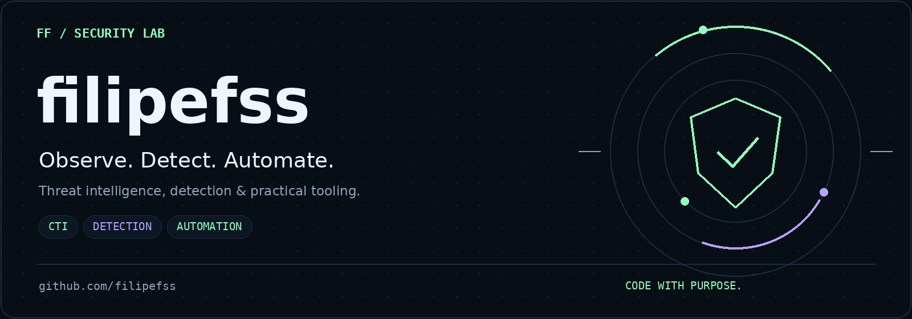
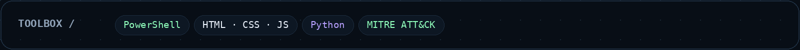
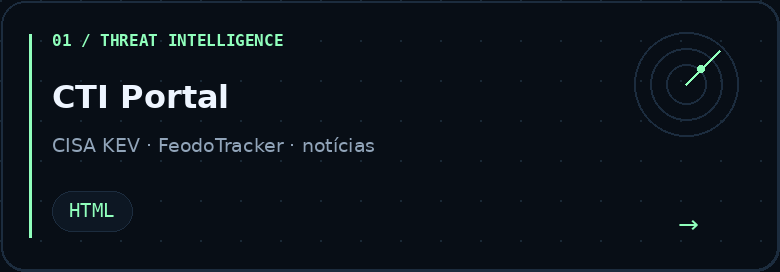
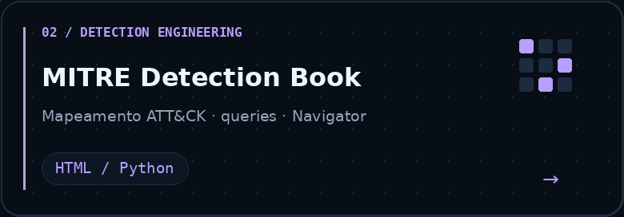
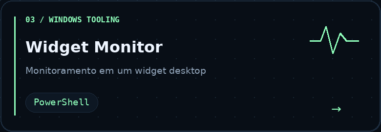
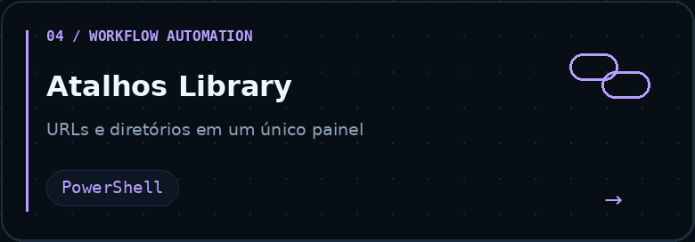
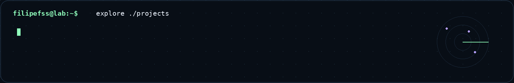

  

  <a href="https://github.com/filipefss?tab=repositories"><strong>Explorar projetos</strong></a>
  &nbsp; / &nbsp;
  <a href="https://github.com/filipefss/CTI-Portal"><strong>Threat intelligence</strong></a>
  &nbsp; / &nbsp;
  <a href="https://github.com/filipefss/mitre-detection-book"><strong>Detection lab</strong></a>

### Olá, eu sou o Filipe.

Meu lab reúne projetos de **inteligência de ameaças, detecção, monitoramento e automação**. Crio ferramentas para organizar informações de segurança, acompanhar sistemas e simplificar o dia a dia com PowerShell e interfaces web.

**Observe. Detecte. Automatize.** Transformar informação em ferramentas úteis é o que conecta os projetos por aqui.

### Projetos em destaque

<table>
<tr>
<td width="50%" valign="top">

 <a href="https://github.com/filipefss/CTI-Portal"><strong>CTI-Portal →</strong></a>

Portal de inteligência de ameaças com CISA KEV, FeodoTracker e notícias.

</td>
<td width="50%" valign="top">

 <a href="https://github.com/filipefss/mitre-detection-book"><strong>MITRE Detection Book →</strong></a>

Book interativo de detecção com mapeamento ATT&CK, queries e Navigator.

</td>
</tr>
<tr>
<td width="50%" valign="top">

 <a href="https://github.com/filipefss/Widget_monitor"><strong>Widget Monitor →</strong></a>

Widget desktop de monitoramento desenvolvido em PowerShell.

</td>
<td width="50%" valign="top">

 <a href="https://github.com/filipefss/Atalhos_lib"><strong>Atalhos Library →</strong></a>

Painel para centralizar URLs e diretórios e facilitar os acessos do dia a dia.

</td>
</tr>
</table>

### Mais do meu lab

- **[Widget Discos](https://github.com/filipefss/Widget_discos)** — widget de monitoramento de armazenamento.
- **[FinFlow](https://github.com/filipefss/finflowapp)** — terminal financeiro pessoal com interface web e recursos de PWA.

### Como este lab se conecta

**Threat intelligence** para organizar o contexto. **Detecção** para estruturar consultas e cobertura. **Monitoramento** para dar visibilidade. **Automação** para reduzir tarefas repetitivas.

  

  <strong>Code with purpose. Share what you learn.</strong> 
  Explore o código, abra uma issue e compartilhe uma ideia.

